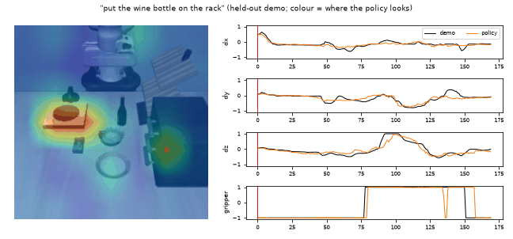
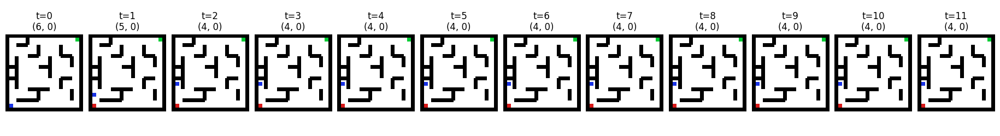
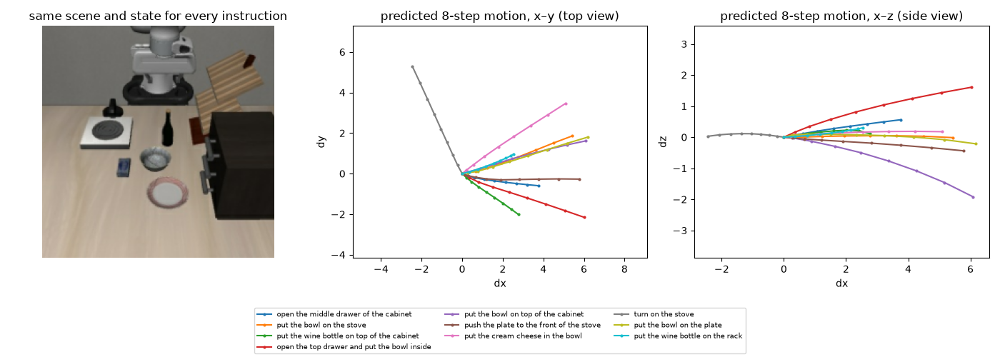

# World Models, Three Ways: Koopman Operators, Selective SSMs & Learned Video Dynamics

A world model predicts how a system evolves under actions. This repository builds
them at four levels of abstraction, from a two-state thermal model to a
language-conditioned robot policy trained on multiple GPUs:

| § | World model | Latent dynamics | Used for | Status |
|---|---|---|---|---|
| [1](#section-1-koopman-operators-for-robust-mpc) | Koopman (EDMD, Deep Koopman) | linear in a lifted space | robust MPC of a 2R2C building model | results |
| [2](#section-2-selective-ssm--koopman-world-model-for-rl) | Selective SSM + Koopman | linear, on top of an input-dependent SSM | A2C on a partially observed CartPole | results |
| [3](#section-3-grid-world--maze-video-world-models) | Pixel-space CNN | none (image → image) | greedy planning in grid worlds and mazes | results |
| [4](#section-4-distributed-training-of-world-models) | Transformer over frozen visual features | predicted future image features | language-conditioned behaviour cloning on robot data (LIBERO), data-parallel | in progress |

<p align="center">
  
</p>

**Figure:** §4. A language-conditioned policy on a held-out robot demonstration.
Left: the camera frame, coloured by where the action tokens attend. Right:
predicted (orange) vs demonstrated (black) actions.

---

## Section 1: Koopman Operators for Robust MPC

This section implements and runs experiments with **Koopman-based Robust Model Predictive Control (RMPC)** on a **2R2C building thermal model**. The core idea is to approximate nonlinear thermal dynamics with a **linear predictor in a lifted (Koopman) space**. Linear MPC techniques then apply, while the predictor keeps the fidelity of the nonlinear system.

There are **two complementary implementations**:

* A **MATLAB implementation** based on classical Extended Dynamic Mode Decomposition (EDMD) with handcrafted basis functions.
* A **Python implementation** using **Deep Koopman learning**, where neural networks learn the lifting functions.

Both follow the same conceptual pipeline and are meant to be compared side by side.

### Problem Overview

The system is a **2R2C thermal building model**, commonly used to describe indoor temperature dynamics under heating/cooling inputs and environmental disturbances. Bilinear and quadratic terms from heat transfer and control interactions make the dynamics nonlinear.

The control objective is to:

* Accurately predict thermal states over a finite horizon
* Enable robust MPC design using a *linear* predictor in lifted space

Koopman operator theory provides the bridge between nonlinear dynamics and linear control.

### Koopman Modeling Approach

Both the MATLAB and Python solutions follow the same logic:

1. **Nonlinear system dynamics:** $x_{k+1} = f(x_k, u_k)$
2. **Data collection:** simulate many trajectories under random excitation to collect $(x_k, u_k, x_{k+1})$ samples.
3. **Lifting to Koopman space:** map the state to a higher-dimensional space, $z_k = \psi(x_k)$.
4. **Linear dynamics in lifted space:** $z_{k+1} = A z_k + B u_k$
5. **State reconstruction:** $x_k \approx C z_k$

The two implementations differ in how the lifting function $\psi(\cdot)$ is constructed.

### MATLAB Implementation (EDMD)

The MATLAB implementation uses **explicit basis functions**:

* Radial Basis Functions (RBFs)
* Original state components

Key characteristics:

* Deterministic lifting map
* Linear regression to identify $A$, $B$ and $C$
* Inspired by the Koopman MPC formulations of Korda & Mezic

This approach is transparent and interpretable, but the basis functions must be designed by hand.

### Python Implementation (Deep Koopman)

The Python implementation replaces handcrafted bases with **learned lifting functions**:

* A neural network encoder learns $z = \psi_\theta(x)$
* Linear layers represent the Koopman operator $(A, B)$
* A decoder maps lifted states back to physical space

The training objectives are:

* One-step prediction loss in state space
* Koopman consistency loss in lifted space

This formulation keeps the Koopman structure, gains expressive power and needs less manual feature engineering.

### Results

The Deep Koopman model achieves:

* Very low one-step prediction error
* Stable short-horizon rollouts
* Gradual divergence over long horizons, consistent with Koopman eigenvalue sensitivity

A representative rollout comparison between the true nonlinear system and the Koopman predictor is shown below.

<p align="center">
  
</p>

**Figure:** Time-domain comparison of true states and Koopman-predicted states for both state variables.

The same Deep Koopman recipe applied to a 4-state CartPole ([`src/deep_koopman_cartpole.py`](src/deep_koopman_cartpole.py)) tracks only the first fraction of a second. After that the long-horizon rollout drifts away, because the swinging pole is much less linear than the thermal model:

<p align="center">
  
</p>

### Key Observations

* Both EDMD (MATLAB) and Deep Koopman (Python) linearize the dynamics in lifted space.
* Deep Koopman is more flexible because it learns task-specific basis functions.
* Long-horizon prediction error comes mainly from small inaccuracies in the Koopman eigenvalues, a known theoretical limitation.

---

## Section 2: Selective SSM + Koopman World Model for RL

Selective-SSM ("Mamba-ish") + Koopman latent linearity + RL (A2C) on POMDP CartPole: [`src/ssm_world_model_koopman_rl.py`](src/ssm_world_model_koopman_rl.py).

The CartPole is made **partially observable**. The agent sees $o_t = [\text{pos}, \sin\theta, \cos\theta]$ plus noise, while both velocities are hidden. A small selective state-space model with input-dependent dynamics, as in Mamba, reads the observation–action history and produces a latent belief $h_t$. A Koopman constraint makes that latent evolve linearly under the action:

$$h_{t+1} \approx A h_t + B u_t, \qquad \hat o_{t+1} = \mathrm{dec}(A h_t + B u_t)$$

$$\mathcal{L}_\text{WM} = \lVert o_{t+1} - \hat o_{t+1} \rVert^2 + \lVert h_{t+1} - (A h_t + B u_t) \rVert^2$$

An actor-critic (A2C) is then trained on the frozen belief $h_t$ instead of the raw observations.

<p align="center">
  
  
</p>

**Figure:** Left: the world model predicts the next cart position one step ahead with RMSE 0.027. Right: A2C episode returns using the SSM–Koopman belief state. They stay noisy (roughly 10–55) over 200 iterations. The belief is informative enough to predict observations, but this short run does not yet produce a stable controller.

---

## Section 3: Grid-World & Maze Video World Models

A third, complementary line of work moves away from Koopman/SSM latent dynamics and instead learns **pixel-space world models**. A CNN maps `(current image, action) → next image` directly, with no explicit state representation or dynamics equations. Planning rolls the learned model forward and greedily minimizes the predicted distance to the goal.

Both experiments share the same recipe:

* Render the environment as a multi-channel semantic image (one channel each for obstacles/walls, start, goal and agent).
* Train a small CNN encoder–decoder (`TinyCNNWorldModel` / `TinyMazeWorldModel`) on randomly sampled `(state, action, next_state)` transitions, using a positive-pixel-weighted BCE loss. Agent and goal pixels are rare, so under-weighting them collapses training.
* At test time, decode the predicted agent position from the model's imagined next frame. Then greedily pick the action whose imagined outcome is closest (Manhattan distance) to the goal, with a penalty for revisiting cells.

**Grid World** ([`WM/Video_Models/GridWM.py`](WM/Video_Models/GridWM.py)): 9×9 grid with block obstacles, start `(0,0)`, goal `(6,6)`.

<p align="center">
  
</p>

**Figure:** Greedy planning with the learned CNN world model. The agent reaches the goal in 12 steps, navigating around obstacles using only image-conditioned next-state predictions (no ground-truth dynamics).

**Maze** ([`WM/Video_Models/Video_GridWM.py`](WM/Video_Models/Video_GridWM.py)): 7×7 maze with explicit interior walls, start `(6,0)`, goal `(0,6)`. Includes a BFS oracle (`bfs_oracle_path`) for comparison against the true shortest path.

<p align="center">
  
</p>

**Figure:** The learned model correctly predicts the first couple of moves, but the greedy planner then stalls at `(4,0)` and never reaches the goal. The policy is a memoryless one-step lookahead over the Manhattan-distance heuristic, so it cannot backtrack out of a local optimum once a wall blocks the locally best action. In the open grid world this never comes up, but tight maze corridors expose this limitation of greedy planning over a learned model.

A related, unexecuted script, [`WM/Video_Models/VM_Planning.py`](WM/Video_Models/VM_Planning.py), sketches a larger video-world-model pipeline (VQ-VAE tokenizer + SSM latent dynamics + MPC) for MetaWorld robotic manipulation, following [iVideoGPT](https://github.com/thuml/iVideoGPT). It depends on external packages (`metaworld`, `mujoco`) that are not vendored here, and it has no results yet.

---

## Section 4: Distributed Training of World Models

The fourth line scales up: world-model objectives on real robot data, trained across multiple GPUs. See the [`dist_training/`](dist_training/README.md) index.

### 4.1 Language-conditioned BC with an auxiliary world-model loss ([`dist_training/WM/`](dist_training/WM/README.md))

A transformer policy reads frozen SigLIP features of the instruction $\ell$, the previous and current frames, and the robot state. From these it predicts an 8-step action chunk **and** the visual features of the frame $k = 4$ steps ahead:

$$(\hat a_{t:t+H},\ \hat z_{t+k}) = f_\theta\big(E_\text{txt}(\ell),\ E(o_{t-1}),\ E(o_t),\ s_t\big)$$

$$\mathcal{L} = \underbrace{\lVert \hat a_{t:t+H} - a_{t:t+H} \rVert_1}_{\text{behaviour cloning}} \;+\; \lambda\, \underbrace{\big[(1-\cos(\hat z_{t+k}, z_{t+k})) + \lVert \hat z_{t+k} - z_{t+k} \rVert^2\big]}_{\text{world model}}$$

Because the encoders are frozen and their features are cached once, training touches only the small transformer and scales well with data parallelism. Results on LIBERO (40 tasks, 1693 demonstrations), with $\lambda = 0$:

| Run | GPUs | Samples/s | Wall-clock | Best val BC (L1) |
|---|---|---|---|---|
| 27M policy | 1 | 1,320 | 16.7 min | 0.131 |
| 27M policy, DDP | 4 | 4,500 (3.4×, 85% efficiency) | 5.1 min | 0.135 |

Offline checks on held-out demonstrations show the policy uses all its inputs. Swapping in another sample's instruction raises the BC loss by 43%, the image by 119% and the robot state by 166%. In a shared scene, its predicted motions also separate by instruction:

<p align="center">
  
</p>

**In progress:** plain BC vs BC + world loss at 300M parameters, closed-loop success in the LIBERO simulator, then DAgger and multi-node runs. Full method, architecture and results are in the [WM report](dist_training/WM/README.md).

### 4.2 Parallelism strategies for video world models ([`dist_training/parallelism/`](dist_training/parallelism/README.md))

This study asks which strategy is best for a video diffusion world model, in pretraining vs LoRA fine-tuning: DDP, ZeRO-2, FSDP, TP, PP or TP×DP. In this regime, sequences of ~10<sup>4</sup> latent tokens make activations, not parameters, the dominant memory cost. The study includes a cost model that predicts the best configuration, with its predictions written down before running.

---

## Repository Structure

```
.
├── results/                        # Experimental results and figures (§1–§3)
│ ├── Koopman_plot1.png             # True vs Koopman rollout comparison
│ ├── One-step obs prediction.png   # SSM–Koopman one-step prediction (POMDP CartPole)
│ ├── A2C return.png                # A2C returns on the SSM–Koopman belief
│ ├── Grid_World_Model.png          # Grid-world CNN world-model rollout
│ └── Maze_WM_Video.png             # Maze CNN world-model rollout
├── deep_koopman_cartpole.png       # Deep Koopman long-horizon rollout on CartPole
│
├── src/                             # Koopman / SSM source code
│ ├── 2R2C_Lifted_EDMD.m            # MATLAB EDMD-based Koopman identification (RBF lifting)
│ ├── deep_koopman_2RRC.py          # Python Deep Koopman implementation (neural lifting)
│ ├── deep_koopman_cartpole.py      # Deep Koopman on CartPole
│ ├── ssm_world_model_koopman_rl.py # Selective-SSM + Koopman + A2C on POMDP CartPole
│ └── simple_WM.py
│
├── WM/Video_Models/                 # Pixel-space (image/video) world models
│ ├── GridWM.py                     # Grid-world CNN world model + greedy planning
│ ├── Video_GridWM.py               # Maze CNN world model + greedy planning + BFS oracle
│ └── VM_Planning.py                # VQ-VAE + SSM + MPC sketch for robotic manipulation
│
├── dist_training/                   # Multi-GPU training of world models (§4)
│ ├── parallelism/                  # DDP / ZeRO / FSDP / TP / PP study + cost model (src/, configs/)
│ └── WM/                           # Language-conditioned BC + world-model loss on LIBERO, DDP
│   └── assets/                     # Figures and GIF used in the READMEs
│
├── blogs.md                        # Reading list
└── README.md
```

---

## References

* M. Korda, I. Mezic, *Linear predictors for nonlinear dynamical systems: Koopman operator meets model predictive control*, Automatica, 2018.
* S. Lusch, J. N. Kutz, S. L. Brunton, *Deep learning for universal linear embeddings of nonlinear dynamics*, Nature Communications, 2018.
* A. Gu, T. Dao, *Mamba: Linear-time sequence modeling with selective state spaces*, 2023.
* B. Liu et al., *LIBERO: Benchmarking knowledge transfer for lifelong robot learning*, NeurIPS Datasets and Benchmarks, 2023.
* X. Zhai et al., *Sigmoid loss for language image pre-training* (SigLIP), ICCV, 2023.

---

## Notes

This repository is intended for research and educational purposes. It started with Koopman-based modeling and control of building energy systems and related thermal processes, and has grown to cover learned world models for control and robot learning.

> 📌 For the latest papers, benchmarks, datasets, and state-of-the-art research on **World Models**, particularly **Spatial and 3D World Models**, please visit our companion repository: **[Awesome Spatial and 3D World Models](https://github.com/Masoudjafaripour/Awesome-Spatial-and-3D-World-Models)**.
